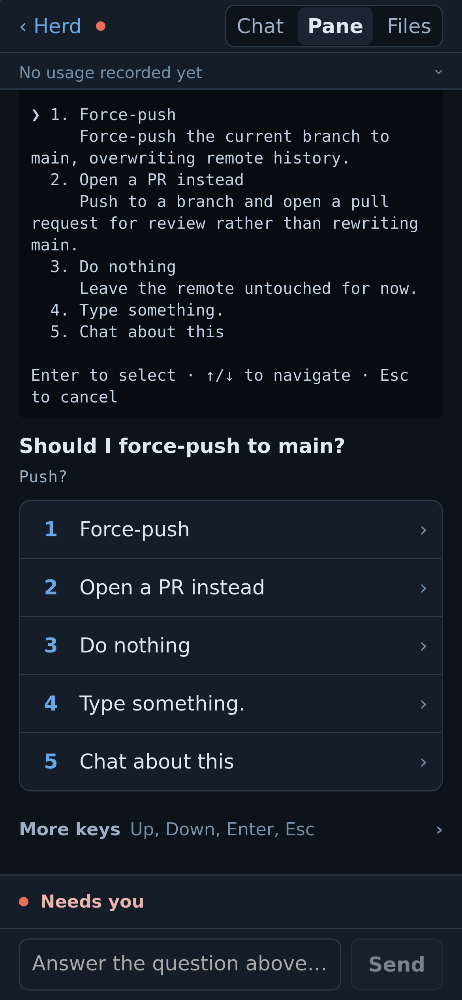
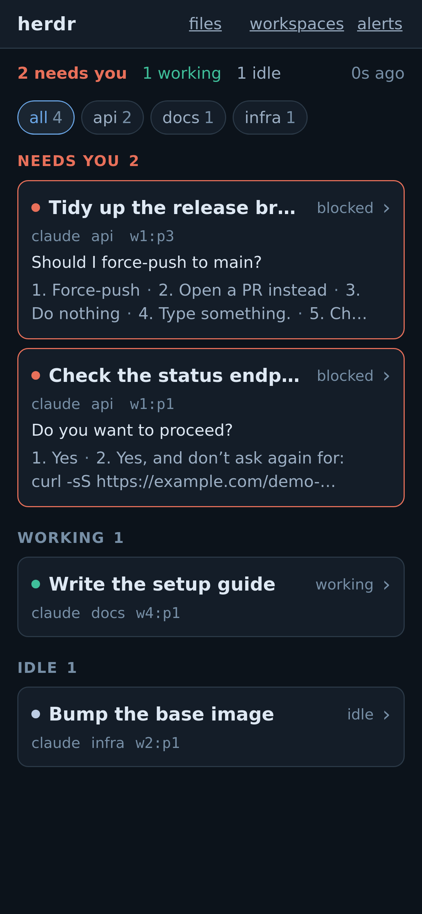
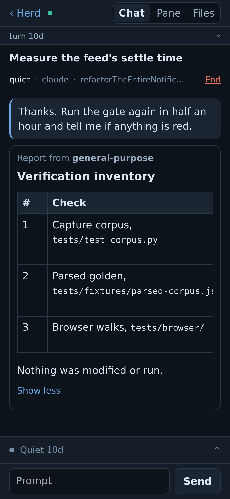
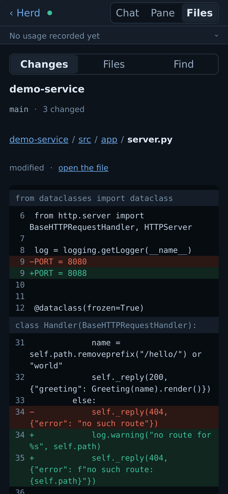

# herdr-pwa

I run several AI coding agents at once in [herdr](https://herdr.dev), a terminal
workspace where each agent lives in its own pane; herdr groups panes into tabs, and tabs
into workspaces. The agents stall whenever they need me, for
a permission prompt, a question or a plan to approve, and the work waits until I'm back
at the desk. herdr-pwa is the phone app I built so I can see which one is waiting, read
what it's doing, and answer it from wherever I am. It's unofficial, for one person, and
reachable only over your [Tailscale](https://tailscale.com) network.

<p>
  
  
  
  
</p>

## What it does

- **Feed.** Every agent in every workspace, sorted by what needs you, with what it's doing,
  and greyed out under a "can't reach herdr" bar when the phone can't reach the app, or the
  app can't reach herdr.
- **Answer.** Permission prompts, menus, checklists and plan approvals are read off the
  screen and drawn as buttons. You can also type a prompt or press any key it offers.
- **Chat.** An agent's conversation drawn as a chat, for Claude Code, opencode and
  [Hermes Agent](https://github.com/NousResearch/hermes-agent).
- **Pane.** The agent's live terminal, as herdr shows it.
- **Files.** A read-only file browser and diff view for the git repos your agents work in.
- **Start and stop.** Open a new agent in a fresh tab, stop one, or close a workspace.
- **Push.** A notification when an agent needs you, or finishes something you haven't read.

## The interesting part: a tap is a keystroke with no undo

herdr's agents are terminal UIs, so there is no API for "answer this question". There's a
screen and there are keystrokes. Every tap travels this path, and any step can refuse:

1. **Find the agent by its session (its conversation), not its pane** (the terminal it
   sits in), because herdr reuses pane ids.
2. **Read the screen again.** If it changed since your phone drew it, the tap is refused.
3. **Send only keys that screen offers.** A key that would open an editor is never offered,
   because the phone couldn't drive or leave the program it opens.
4. **Write the audit record, then send.** If the record can't be written, nothing is sent.
5. **Read back, never re-send.** After sending, the app reads the screen to confirm the keys
   landed. If it can't tell, it shows "Sent, unverified", and sends again only if you tap
   "Send again anyway".

## Security model

Tailscale is the only lock on the door. It joins your own devices into a private network,
called a tailnet. `tailscale serve`, a command that runs on the same machine as
herdr-pwa, receives each request from your phone and adds a header naming the Tailscale
account that sent it. (Strictly, the Tailscale background service does this, and the
`tailscale serve` command sets it up.) The app trusts that header, so there is no password or token.

- **Only the machine can reach the app directly.** `herdr-pwa serve` listens only on the
  loopback address `127.0.0.1`, which other machines can't reach. So nobody on the network
  can send the app a forged header; only `tailscale serve` can pass requests to it.
- **Pin your own account.** Set `HP_TAILNET_LOGIN` to your Tailscale login, and the app
  refuses every other account. Without it, anyone your tailnet lets reach the machine can
  control every agent, and the app warns you when it starts.
- **Web pages on the machine get nothing.** A page in a local browser could point its own
  web address at `127.0.0.1` and send requests to the app. The trick abuses the Domain
  Name System (DNS), so it is called DNS rebinding. The app ignores the header unless the request is addressed to the machine's Tailscale
  name. That is the `*.ts.net` name that Tailscale's MagicDNS gives it, and the page can't
  send it.
- **Scripts on the machine can skip the header.** `HP_ASSUME_LOGIN` lets requests that have
  no header act as the login it names. It works only for requests addressed to `127.0.0.1`
  or `localhost`. The app refuses to start with it while `tailscale serve` is on.
- **`pair` stays inside your tailnet.** It never uses Funnel, Tailscale's feature for
  sharing a machine with the whole internet. It refuses a machine that already has Funnel
  on. It adds itself beside an existing `tailscale serve` setup, and refuses to replace one.
- **Anyone with a shell on the machine is trusted**, since they can reach the loopback
  address too.
- **Agents do what they're told.** Whether a prompt is safe to run is left to the agent's
  own permission prompts.

The full threat model, and how to report a security problem, are in
[SECURITY.md](SECURITY.md).

## Running it

You need Linux, Python 3.13 or later with [uv](https://docs.astral.sh/uv/), and herdr on
the same machine. You also need Tailscale, with MagicDNS (names for your machines) and
HTTPS certificates turned on in its admin console. The app knows exactly one version of
the protocol herdr uses to talk to other programs (version 22 today), and it won't type
into a herdr that speaks another. A misread screen could send the wrong keys, so it
refuses instead. `doctor`, below, tells you whether your herdr matches.

```sh
uv sync
export HP_TAILNET_LOGIN=you@example.com
export HP_PUSH_SUBJECT=mailto:you@your-real-domain
uv run herdr-pwa serve   # listens on 127.0.0.1:8772 and keeps running
# then, in another terminal:
uv run herdr-pwa pair    # publishes it with tailscale serve, prints a QR code
```

`HP_PUSH_SUBJECT` is the contact address the app gives to push services when it sends a
notification. Use an address at a real domain: Apple rejects a placeholder, and then your
iPhone gets no notifications.

On the phone, open the URL from the QR code, add it to the Home Screen, open it from there,
and tap "alerts" at the top, then "Turn on alerts here". On an iPhone, notifications need iOS 16.4 or later, and they work only
in the app opened from the Home Screen.

Run `uv run herdr-pwa doctor` to check the setup. It fails if any of these is true:

- herdr isn't answering, or speaks a protocol version the app doesn't know.
- The running service started from older code than the code on disk, so it needs a restart.
- The app can't learn the machine's Tailscale name, so it would refuse every request.

Every setting is an environment variable whose name starts with `HP_`; the full list is in
`src/herdr_pwa/settings.py`. The app keeps its state, such as the audit log and the devices
that get notifications, in `~/.config/herdr-pwa`.

## How it fits together

Python (FastAPI, Jinja) on the server, htmx and a little plain JS on the phone, with no
build step. The code in `src/herdr_pwa/` is in layers, listed here from the top. Each layer
imports only the layers below it, and import-linter checks that in the test run:

- `web/` holds the routes, templates, the event stream and the push notifier.
- `writes/` is the path above: resolve, check, audit, send, read back.
- `files/` reads git in-process through libgit2, so no command a repo configures, such as
  a git hook or filter, ever runs.
- `decisions.py` decides what every view and push shows, so they all agree.
- `render/` turns Markdown, code and maths into element trees, so agent text never becomes HTML.
- `engine/` talks to herdr over its socket, reads screens and transcripts, ranks agents.

## How it's checked

`just check` runs the linter, a strict type checker, the tests, and a layout check at
phone widths in headless Firefox. CI (the automated checks GitHub runs) uses the same
recipe on every pull request and every push to `main`.

Tests never touch a real herdr. They run on screens and transcripts captured from real
agents, kept in `tests/fixtures/`. Beside those screens sits a record of the decision
expected on each one, such as "this screen is a permission prompt".

The tests check that the code still makes each recorded decision. Where it deliberately
decides differently, the test is marked as an expected failure, with the reason.

For development you also need [just](https://just.systems), Node and Firefox. Once per
clone, run these:

```sh
npm ci --ignore-scripts
uvx pre-commit install --hook-type pre-commit --hook-type commit-msg
ln -s ../../scripts/hooks/pre_push.py .git/hooks/pre-push
```

The hooks run the formatter and linter on each commit, check the commit message's length,
and refuse a push that would publish a private name, such as a real login, a home folder path
or a tailnet name. `just live-session` starts a
throwaway herdr session, so you can try the app without touching your own agents.

## How it was built

The code was written by AI coding agents, working to the rules in [AGENTS.md](AGENTS.md)
and directed by me.

## Contributing

Issues and pull requests are welcome. This is a personal project, so I handle them when I
can and can't promise how quickly.

## Licence

herdr-pwa is released under the MIT licence; see [LICENSE](LICENSE). It includes a copy of
htmx 2.0.10, under its own 0BSD licence, in `src/herdr_pwa/web/static/`. The test screens
in `tests/fixtures/foreign/collie/` come from [collie](https://github.com/AltanS/collie),
and its MIT notice sits beside them.
