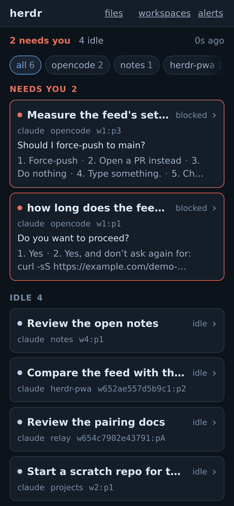
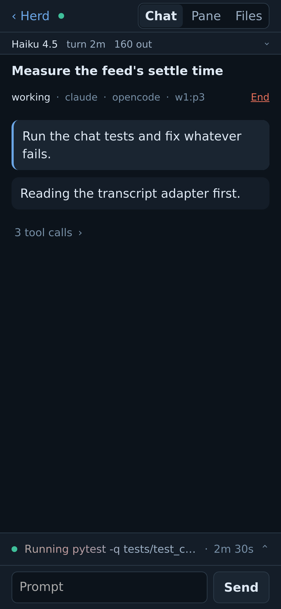

# herdr-pwa

I run several AI coding agents at once in [herdr](https://herdr.dev), a terminal
workspace where each agent lives in its own pane. They stall whenever they need me, for
a permission prompt, a question or a plan to approve, and the work waits until I'm back
at the desk. herdr-pwa is the phone app I built so I can see which one is waiting, read
what it's doing, and answer it from wherever I am. It's an unofficial companion for one
person: it runs beside herdr, and only you can reach it, over your
[Tailscale](https://tailscale.com) network.

<p>
  
  
  
  
</p>

## What it does

- **Feed.** Every agent in every workspace, sorted by what needs you, with what it's doing.
- **Answer.** Permission prompts, menus, checklists and plan approvals are read off the
  screen and drawn as buttons. You can also type a prompt or press any key it offers.
- **Chat, Pane, Files.** The transcript as a chat (Claude Code, opencode and
  [Hermes Agent](https://github.com/NousResearch/hermes-agent)), the live terminal, and a
  read-only browser and diff for the git repos your agents work in.
- **Start and stop.** Open a new agent in a fresh tab, stop one, or close a workspace.
- **Push.** A notification when an agent needs you, or finishes something you haven't read.
- **Honest when cut off.** An amber "can't reach herdr" bar, and the stale cards grey out.

## The interesting part: a tap is a keystroke with no undo

herdr's agents are terminal UIs, so there is no API for "answer this question". There's a
screen and there are keystrokes. Every tap travels this path, and any step can refuse:

1. **Find the agent by its session, not its pane**, because herdr reuses pane ids.
2. **Read the screen again.** If it changed since your phone drew it, the tap is refused.
3. **Send only keys that screen offers.** `ctrl+g` opening Vim is never a button.
4. **Write the audit record, then send.** No record, no write.
5. **Read back, never re-send.** "Sent, unverified" waits for an explicit "Send again anyway".

What a prompt asks an agent to run is left to that agent's own permission prompts.

## Security model

- **Tailscale is the boundary.** The app trusts the `Tailscale-User-Login` header that
  `tailscale serve` adds, and nothing else: no password, no token. `serve` binds only
  loopback, so no other machine can send that header itself.
- **Only on the node's own name.** The header counts only when the Host is this node's
  MagicDNS name, so a web page that rebinds its name to `127.0.0.1` gets nothing.
- **Pin your login** with `HP_TAILNET_LOGIN`. Without it, anyone your tailnet lets reach
  the machine can drive every agent, and startup warns you.
- **`pair` never uses Funnel** (Tailscale's public-internet sharing), refuses a node that
  has Funnel on, and never resets an existing `tailscale serve` config.
- **Anyone with a shell on the machine is trusted**, since they reach loopback too.

The threat model and how to report a hole are in [SECURITY.md](SECURITY.md).

## Running it

You need Linux, Python 3.13+ with [uv](https://docs.astral.sh/uv/), herdr on the same
machine, and Tailscale with MagicDNS and HTTPS certificates on. The app pins herdr's
socket protocol (`src/herdr_pwa/protocol.py`) and won't type into a herdr that differs.

```sh
uv sync
export HP_TAILNET_LOGIN=you@example.com
export HP_PUSH_SUBJECT=mailto:you@your-real-domain  # a real address, or Apple drops pushes
uv run herdr-pwa serve   # listens on 127.0.0.1:8772
uv run herdr-pwa pair    # publishes it with tailscale serve, prints a QR
```

On the phone, open the URL, add it to the Home Screen, open it from there and turn
alerts on (on iPhone, push needs the Home Screen app and iOS 16.4+).

`uv run herdr-pwa doctor` exits non-zero if herdr is unreachable or speaks another
protocol, the service is older than the code, or the node's name is unknown. Settings
are `HP_*` environment variables (`src/herdr_pwa/settings.py`), and state lives in
`~/.config/herdr-pwa-v2`.

## How it fits together

Python (FastAPI, Jinja) on the server, htmx and a little plain JS on the phone, with no
build step. The layers in `src/herdr_pwa/` only point down, and import-linter holds them:

- `engine/` talks to herdr over its socket, reads screens and transcripts, ranks agents.
- `decisions.py` decides what every view and push shows, so they all agree.
- `writes/` is the path above: resolve, check, audit, send, read back.
- `web/` holds the routes, templates, the event stream and the push notifier.
- `files/` reads git in-process through libgit2, so no command a repo configures ever runs.
- `render/` turns Markdown, code and maths into node trees, never into markup strings.

## How it's checked

`just check` runs formatting and lint (ruff, ESLint, import-linter), strict types, the
tests, and a phone-width layout check in headless Firefox; CI runs the same recipe.
Tests never touch a real herdr: they run on captured screens and transcripts in
`tests/fixtures/`. Every decision an earlier version of this app made over those screens
is frozen in `tests/fixtures/ledger.json`, and where this one deliberately disagrees, the
test is a strict xfail that says why.

For development you also need [just](https://just.systems), Node and Firefox. Once per
clone, run `npm ci --ignore-scripts` and install the git hooks the way
`.pre-commit-config.yaml`'s header says. `just live-session` starts a throwaway herdr.

## How it was built

<!-- OWNER: edit this paragraph -->
I built this with AI coding agents I directed: they wrote most of the code, each on its
own branch, under the rules in [AGENTS.md](AGENTS.md). I owned the rules, the review and
every merge, and judged each screen on a real phone. Before rewriting the first version,
I froze every decision it made into the ledger, so the new code had to match it or say why.

## Contributing

This is a personal project: outside issues and pull requests are handled when I can,
with no SLA.

## Licence

MIT, see [LICENSE](LICENSE). Vendored: htmx 2.0.10 (0BSD), in `src/herdr_pwa/web/static/`.
The screens in `tests/fixtures/foreign/collie/` come from
[collie](https://github.com/AltanS/collie) and keep its MIT notice beside them.
